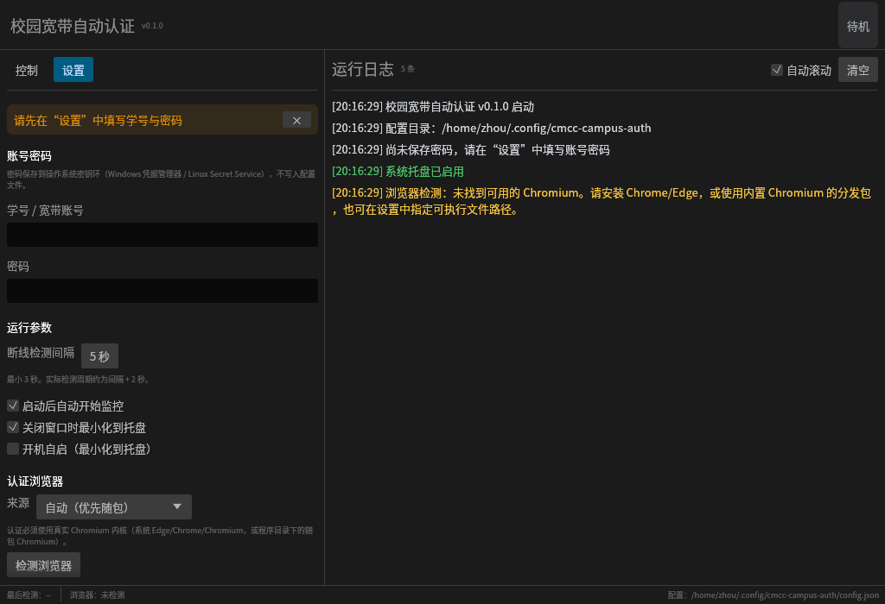

# 校园宽带自动认证（Rust + Tauri 版）

中国移动校园宽带 Portal 认证的**断线自动重连**桌面应用。Rust + Tauri 2（系统 WebView）
重写自 [cmcc-campus-auth](https://github.com/kiiki290/cmcc-campus-auth)（Python CLI 版）。

断线后自动重新认证；验证码由本地 OCR 识别；密码保存在操作系统密钥环；关闭窗口可常驻托盘。



## 功能

- **断线自动重连**：轮询黑洞地址判断在线状态，掉线即自动重走认证流程
- **紧凑 GUI**：Tauri 2 + 系统 WebView（无 Electron），状态/认证阶段条、立即认证/取消、
  开始/停止监控、实时日志、设置；浅色/深色跟随系统
- **系统托盘**：关闭到托盘、托盘菜单快捷操作
- **单实例**：重复启动会唤起已有窗口，避免双开互踢
- **开机自启**：Windows 当前用户注册表 / Linux XDG Autostart
- **凭据安全**：密码存系统密钥环（Windows 凭据管理器 / Linux Secret Service），不写入配置文件
- **验证码本地识别**：ddddocr 模型直接编译进程序，首次运行无需联网下载
- **两种浏览器分发**：使用系统 Edge/Chrome/Chromium，或随包携带 headless Chromium
- **低开销前端**：纯 HTML/CSS/JS（无框架、无构建步骤、无 Node 运行时依赖），
  日志批量 IPC、前端内存上限 1500 行 / DOM 600 节点

## 重要说明（先读）

- **认证必须经过真实 Chromium 内核**。Portal 前的瑞数（Riversec）动态防护会用
  202 挑战页拦截纯 HTTP POST；表单必须由页面内 JavaScript `form.submit()` 提交。
  因此本程序依赖 Chrome/Edge/Chromium，无法做成纯 HTTP 客户端。
- **已在真实校园网完成单次认证全流程验证（2026-10-29）**：修复瑞数挑战问题后，
  使用系统 Edge 跑通 探测→加载认证页→定位 frame→验证码 OCR→JS 提交→结果解析→
  BRAS 放行确认，日志显示“认证成功”并确认在线。此前的“找不到认证 Frame”已定位并
  修复（chromiumoxide stealth 补丁被瑞数识别，挑战后返回空页面）。断线自动重连的
  长时间稳定性仍建议观察；仓库内另有本地 mock Portal + 真实 `chrome-headless-shell`
  的端到端测试。
- 只针对特定 Portal（`218.200.239.185:8888/portalserver`，华为/H3C 系网关 +
  瑞数动态防护 + `unionautologin.do` 表单）验证过，换网络环境不一定可用。
- 认证页仅校园网内可达；在校外运行时探测会超时，程序按“在线”处理并静默待命。

## 使用预编译包

| 版本 | 内容 | 要求 |
|---|---|---|
| `lite` | 仅程序 | 系统已安装 Edge / Chrome / Chromium |
| `bundled` | 程序 + `chromium/` | 无额外要求，体积约 200 MB |

- **Windows**：Windows 10/11 x64。lite 版会自动查找 Edge/Chrome；bundled 版免安装浏览器。
- **Linux**：lite 版需安装 `chromium` 或 `google-chrome`；bundled 版自带。仓库提供的
  Linux 包在 Ubuntu 26.04 x86_64 上构建，较旧的发行版（glibc 过旧）请从源码构建；
  arm64 可自行构建（打包脚本支持，但未实机验证）。
- GNOME 桌面需要 **AppIndicator / Ubuntu AppIndicators 扩展**才能显示托盘图标
  （Ubuntu 默认启用）。托盘不可用时会退化为关闭窗口即退出；若窗口已隐藏但看不到
  托盘图标，再次启动程序会唤起已有窗口。

首次启动：进入「设置」填写学号与密码 → 保存 → 回到「控制」开始监控。
程序会记住账号、检测间隔、浏览器来源等设置；密码存入系统密钥环。

## 从源码构建

要求 Rust **1.92+**（edition 2024）。前端是纯静态文件，**不需要 Node 构建**；
Tauri CLI 仅用于 `tauri dev` 热更新和生成 deb/AppImage/NSIS 安装包。

```bash
# 首次构建会下载 onnxruntime 预编译库（ort crate），需要联网
cargo run --release            # 直接编译运行（ui/ 在编译期嵌入二进制）

# 开发时前端改动即时生效（需要 Tauri CLI）
npm i -g @tauri-apps/cli@2
tauri dev
```

Linux 构建依赖（Tauri 2 + WebKitGTK 4.1，需 Ubuntu 22.04+/Debian 12+ 等提供 webkit2gtk-4.1 的发行版）：

```bash
sudo apt install build-essential pkg-config curl wget file \
    libwebkit2gtk-4.1-dev libgtk-3-dev libsoup-3.0-dev \
    librsvg2-dev libayatana-appindicator3-dev libxdo-dev libssl-dev
```

Windows 上安装 Rust（MSVC 工具链）与 Visual Studio Build Tools，然后直接
`cargo build --release`；首次构建同样会下载 onnxruntime。运行时需要 WebView2
（Windows 10/11 一般已预装；离线环境可用 Tauri 的 offline installer 配置）。

Windows 也可用启动脚本（自动判断是否需要重新构建，然后启动）。
脚本需要 PowerShell 7（`pwsh`，7.0 及以上）；Windows 自带的 Windows PowerShell 5.1
不满足（`#requires -Version 7.0`），请先安装 PowerShell 7（如
`winget install --id Microsoft.PowerShell`）：

```powershell
.\scripts\run.ps1              # release 构建并启动
.\scripts\run.ps1 -DebugBuild  # 使用 debug 构建
.\scripts\run.ps1 -NoBuild     # 跳过构建，直接启动
.\scripts\run.ps1 --minimized  # 透传程序参数
```

也可以直接双击仓库根目录的 `启动.bat`（内部调用 `scripts\run.ps1`，失败时窗口会暂停显示错误）。

运行测试：

```bash
cargo test
```

需要真实浏览器的端到端测试默认忽略，手动运行：

```bash
# 准备一个 chrome-headless-shell（可从 Chrome for Testing 下载）
CMCC_BUNDLED_CHROMIUM=/path/to/chrome-headless-shell CMCC_ALLOW_LOOPBACK=1 \
    cargo test mock_portal_auth_flow -- --ignored --nocapture

# OCR 冒烟测试
CMCC_TEST_CAPTCHA=/path/to/captcha.png \
    cargo test ocr_smoke -- --ignored --nocapture
```

也可以启动本地 mock Portal 手动验证 GUI：

```bash
python3 scripts/mock_portal.py
# 另开终端，把下面的环境变量指向 mock 地址并运行程序
export CMCC_PROBE_TARGET=127.0.0.1:18888
export CMCC_RELEASE_TARGET=127.0.0.1:18889
export CMCC_ALLOW_LOOPBACK=1
export CMCC_NO_SANDBOX=1
./target/debug/cmcc-campus-auth
```

启动参数：

```text
--minimized     启动后最小化到托盘（开机自启使用）
--version / --help
```

调试界面可用 `tauri dev` 打开 WebKit Inspector，或用系统截图工具截取窗口
（原 `--screenshot` 调试模式已随 egui 一并移除）。

## 打包两个分发版本

```bash
# Linux：生成 dist/*-lite.tar.gz 与 dist/*-bundled.tar.gz
scripts/package.sh

# Windows（在 Windows 上运行）
powershell -ExecutionPolicy Bypass -File scripts\package.ps1
```

前端已嵌入二进制，上面的便携包与旧版结构一致。需要系统安装包时：

```bash
# Linux deb + AppImage（lite）
npx @tauri-apps/cli@2 build --bundles deb,appimage

# bundled 版 deb：先把 chromium 放到 src-tauri/chromium/，再合并资源覆盖配置
npx @tauri-apps/cli@2 build --bundles deb --config src-tauri/tauri.bundled.conf.json

# Windows NSIS 安装包（需在 Windows 上运行，WebView2 默认在线引导安装）
npx @tauri-apps/cli@2 build --bundles nsis
```

`scripts/fetch_chromium.sh|.ps1` 会从 Chrome for Testing 清单下载当前稳定版
`chrome-headless-shell`（Linux 缓存在
`~/.cache/cmcc-campus-auth/chrome-for-testing`，Windows 在
`%LOCALAPPDATA%\cmcc-campus-auth\chrome-for-testing`，重复打包不再下载）。
Linux 打包需要 `curl`、`jq`、`unzip`。程序启动时按以下顺序解析浏览器：

1. 环境变量 `CMCC_BUNDLED_CHROMIUM`（开发/测试用，优先级最高）
2. Tauri 资源目录下的 `chromium/`（deb/AppImage 安装包用）
3. 随包目录：程序目录下 `chromium/`、`chrome-headless-shell/`、`browser/`
   `resources/chromium/`（递归查找）
4. 系统浏览器：Windows 的 Edge/Chrome/Chromium；Linux 的 `chromium`、
   `google-chrome`、`microsoft-edge` 等

“自定义路径”是独立的浏览器模式（`browser_mode=custom`），不参与自动解析。

## 配置与凭据

| 项目 | Linux | Windows |
|---|---|---|
| 配置 | `~/.config/cmcc-campus-auth/config.json` | `%APPDATA%\cmcc-campus-auth\config.json` |
| 浏览器 profile | `~/.local/share/cmcc-campus-auth/` | `%LOCALAPPDATA%\cmcc-campus-auth\` |
| 密码 | Secret Service | 凭据管理器 |
| 运行日志 | `~/.config/cmcc-campus-auth/app.log` | `%APPDATA%\cmcc-campus-auth\app.log` |

配置文件保存学号、检测间隔、浏览器来源等；**密码不在配置文件中**，由系统密钥环管理，
换机/换用户无法读取。首次使用请重新输入；旧 Python 版（DPAPI 密文）的配置不会自动迁移。

检测间隔默认 5 秒，最小 3 秒；实际检测周期约为「间隔 + 2 秒」（在线时黑洞探测要等满超时）。

## 工作原理

1. **探测 = 找 Portal**：向黑洞 IP `192.0.2.1`（TEST-NET-1，RFC 5737）发 `:80` 请求。
   - 未认证：BRAS 网关对任意目的 `:80` 无差别 302 到 Portal，Location 含 `wlanuserip=`
     → 断线，同时得到认证页 URL 和本机 WAN IP；
   - 已在线：黑洞目标永不应答 → 超时 → 在线；
   - 其余任何结局都按在线处理（网络全断时也没有可认证的对象）。
2. **认证**：启动无头 Chromium → 打开认证页 → 定位 `unionautologin.do` 子 frame
   （找不到时回落 `frames[1]`）→ 取 JSESSIONID → 拉验证码图片 → ddddocr 识别 →
   填写 `#username` / `#pwd` / `#ps` → 页面 JS `form.submit()` 提交。
3. **确认放行**：收到「登录成功」后，用真实主机 `1.1.1.1` 做 0/1/2/3/5/8 秒递增探测，
   确认 BRAS 真正放行；页面成功但未放行时按本轮失败重试。
4. **重试**：单次认证最多 3 轮；监控模式下 3 轮失败会等待 30 秒后继续检测，
   只有密码错误、欠费、停机/冻结/锁定等致命错误才停止监控并弹窗提示。
5. **防钓鱼校验**：默认只允许把密码提交给 `218.200.239.185:8888`，并要求认证
   frame 与表单 action 同源；本机回环地址仅在 debug/test 构建或设置
   `CMCC_ALLOW_LOOPBACK=1` 时允许（供 mock 测试）。其他 Portal 部署需设置
   `CMCC_PORTAL_HOST=host1,host2:port` 白名单，否则认证会主动中止且不重试。
6. **浏览器环境**：UA 使用真实浏览器版本/平台（去掉 Headless 标记），并通过 CDP
   将语言与 Accept-Language 设为 `zh-CN`，避免 Portal 返回英文结果页。只覆盖 UA，
   不启用 chromiumoxide 的 stealth 补丁——这些补丁会被瑞数识别，导致挑战后返回
   空页面（实网复现）；`navigator.webdriver` 由 `--disable-blink-features=AutomationControlled` 关闭。

轮询探测只发黑洞地址请求，不会给任何外部服务器增加压力。

## 代码结构

```text
ui/                        前端（纯静态，无构建步骤）
├── index.html             控制页 / 设置页 / 日志 / 对话框
├── style.css              设计令牌、浅色/深色、组件样式
└── app.js                 状态机、Channel 订阅、日志环形缓冲

src-tauri/                 Rust 端（Tauri 2）
├── tauri.conf.json        窗口、CSP、打包配置
├── capabilities/          最小权限（core:default）
├── icons/                 平台图标（由 icon.rs 程序化生成）
└── src/
    ├── main.rs            CLI、Tauri Builder、托盘、窗口生命周期
    ├── lib.rs             模块导出（测试/示例共用）
    ├── commands.rs        IPC 命令与设置保存/清除等业务规则
    ├── state.rs           AppState、快照、初始数据 Bootstrap
    ├── bridge.rs          EngineEvent → Channel 批量转发 + 日志环
    ├── window.rs          显示/聚焦主窗口、启动显示策略
    ├── engine.rs          单次认证 / 断线监控任务
    ├── auth.rs            认证流程、JS 注入、结果解析、重试
    ├── browser.rs         Chrome/Edge 定位与 chromiumoxide 启动
    ├── ocr.rs             ddddocr 模型（内嵌）与识别
    ├── probe.rs           黑洞探测 / 放行确认（HTTP 原始报文解析）
    ├── config.rs          配置读写、路径
    ├── credentials.rs     系统密钥环
    ├── tray.rs            Tauri 托盘菜单 + Linux 宿主探测
    ├── autostart.rs       开机自启（AppImage 用 $APPIMAGE）
    ├── events.rs          核心→界面事件（含认证阶段埋点）
    ├── logging.rs         追加式文件日志 app.log
    └── icon.rs            运行时绘制图标
assets/
├── models/common_old.onnx      ddddocr 旧版 OCR 模型（约 13 MB，MIT）
└── test/captcha_6971.png       测试用验证码
```

## 与原 Python 版的差异

- CLI → 桌面 GUI（Tauri 2 + 系统 WebView），内置托盘、单实例、开机自启
- Windows DPAPI → 跨平台系统密钥环（Windows 凭据管理器 / Linux Secret Service）
- Python Playwright + bundled Chromium → Rust chromiumoxide + 系统/随包 Chromium
- Python ddddocr → ddddocr-rs（`ddddocr-core` + `ddddocr-ort`），模型字节内嵌
- 验证码 URL 不再双源硬编码：从 302 得到的 Portal URL 推导 `/portalserver` 根地址
- 在线探测、认证步骤、重试策略、致命错误列表与原版保持一致
- **浏览器反检测策略刻意与 Python 版一致**：只用 `--disable-blink-features=AutomationControlled`
  和 UA 覆盖，不启用 chromiumoxide 的 stealth 补丁。Python/Playwright 没有这一步；
  Rust 重写时多加的 stealth 补丁会被瑞数识别并返回空页面（2026-10-29 实网修复）。
  Python 版的 Playwright `page.route` 瑞数脚本回放是为其请求拦截机制服务的，
  chromiumoxide 默认不开启请求拦截，因此无需移植。

## 资源占用

release 构建，Linux + WebKitGTK 2.52，窗口可见、待机（未监控）状态实测
（同一进程树，2026-10-30）：

| 进程 | RSS | PSS |
|---|---:|---:|
| 主进程（Rust + GTK） | 约 154 MB | 约 56 MB |
| WebKitWebProcess | 约 169 MB | 约 60 MB |
| WebKitNetworkProcess | 约 49 MB | 约 15 MB |
| **合计** | 约 373 MB（共享库被重复计入） | **约 132 MB** |

- 空闲 CPU ≈ 0%：事件驱动，无定时重绘、无常驻动画；仅认证任务运行时才有负载。
- 迁移前的 egui 版为单进程约 50–80 MB。Tauri 的系统 WebView 多进程模型必然带来
  约 +50–80 MB 常驻开销（PSS 口径），这是换取界面表现力的代价，仍显著低于
  Electron（约 200–350 MB）。debug 构建会因符号与未优化代码明显更高，请以
  release 为准。
- 数值随页面内容、日志条数与渲染后端波动（上次最小化状态下测得 PSS 约 151 MB）。
  本次在 Xvfb + 软件渲染下测量以绕过开发机会话的 WM 异常；真实 GPU 合成下可能略有差异。

## 已知局限

- 单次认证已在真实校园网验证（2026-10-29）；断线自动重连的长时间稳定性尚未专门
  压测，瑞数/WAF 行为变化仍可能导致认证失败
- 认证结果依赖 Portal 对 POST 直接返回结果页；若 Portal 改为多段跳转，需要适配
- 账号密码只支持单账号
- 托盘显示依赖桌面环境的 StatusNotifier 支持（GNOME 需 AppIndicator 扩展）；Linux 上
  Tauri 不转发托盘图标点击事件，请用菜单项「显示主窗口」
- **内存开销高于 egui 版**：Tauri 使用系统 WebView，Linux 为 WebKitGTK 多进程、
  Windows 为 WebView2 多进程。前端已按最低开销实现（无框架、无动画、日志上限），
  但常驻内存仍明显高于纯 Rust 立即模式 GUI（PSS 合计约 132 MB，见「资源占用」）
- Windows 运行时依赖 WebView2（Win10/11 通常已预装；无网络的校园环境请用带
  offline installer 的安装包）
- 部分 NVIDIA + Wayland 环境 WebKitGTK 的 DMA-BUF 渲染会显示空白窗口，可设置
  `WEBKIT_DISABLE_DMABUF_RENDERER=1` 后重启程序（本机未复现，仅记录已知规避法）
- Linux 若使用 snap 版 Chromium，自定义 profile 可能受沙箱限制；启动失败时建议改用
  bundled 版或 Google Chrome 的 deb 包
- Ubuntu 23.10+ 默认限制 unprivileged user namespaces，随包 `chrome-headless-shell`
  没有 AppArmor profile 时无法启用沙箱；程序会自动以 `--no-sandbox` 重试并在日志中警告
  （浏览器进程隔离性降低）。系统 Chrome/Chromium 的 deb 包通常自带 AppArmor profile，
  可继续使用沙箱
- Windows 版本已在 Windows 11 + MSVC 工具链下完成编译、单元测试、GUI 运行、
  mock Portal 端到端与实网单次认证验证（2026-10-29）；断线自动重连长稳仍建议观察
- 旧版配置文件/DPAPI 密码不自动迁移

## License

[MIT](LICENSE) © 2026 kiiki290

验证码模型来自 [ddddocr](https://github.com/sml2h3/ddddocr)（MIT），
Rust 推理实现使用 [ddddocr-rs](https://github.com/CNWeiWei/ddddocr-rs)（MIT OR Apache-2.0）。
随包 Chromium 来自 [Chrome for Testing](https://googlechromelabs.github.io/chrome-for-testing/)。
